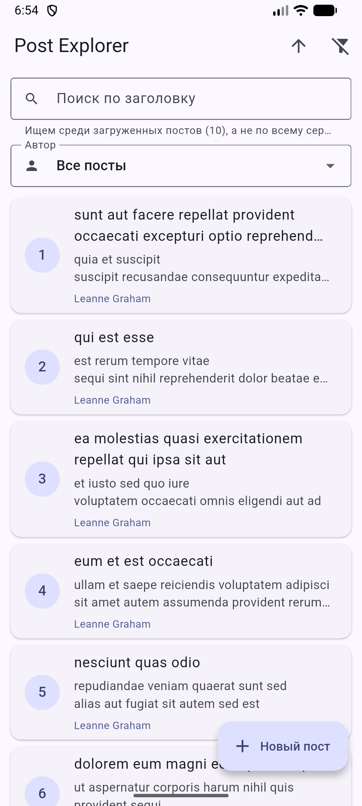
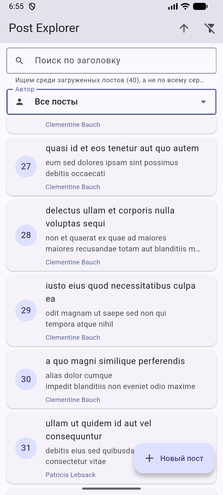
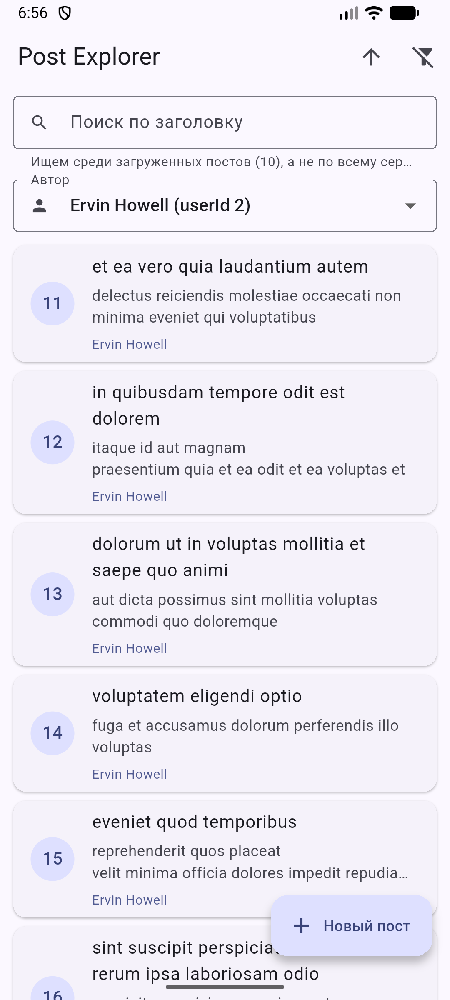
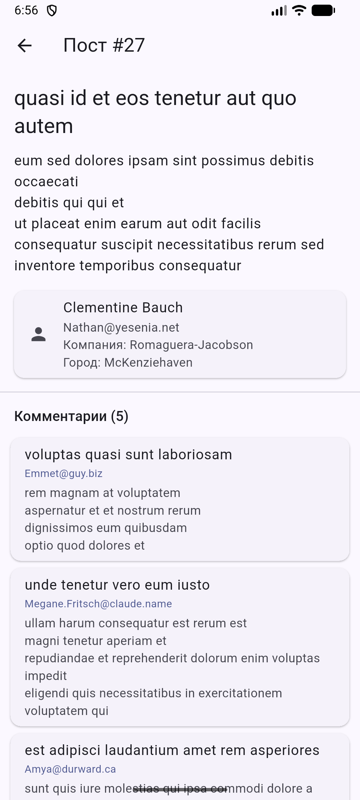
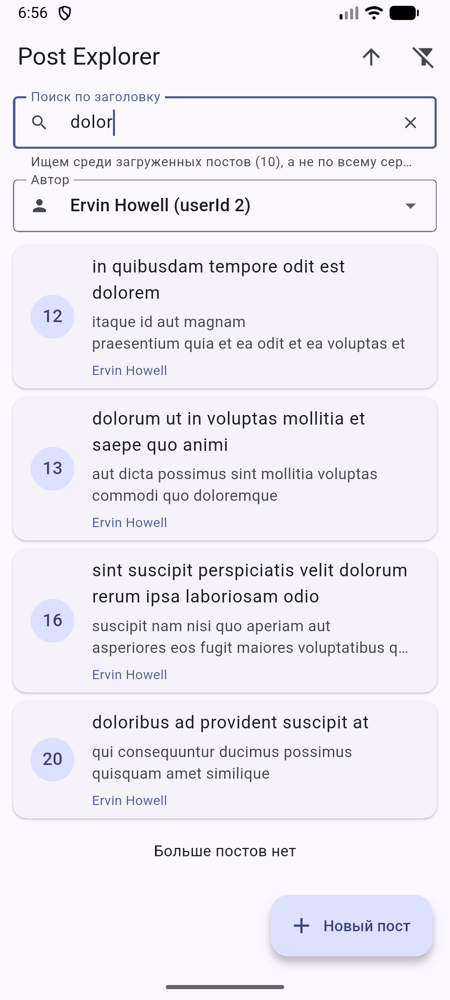
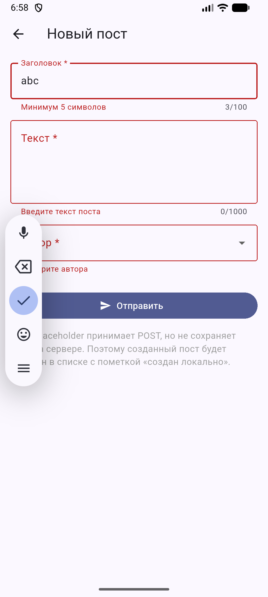

# СРС 8 — Post Explorer

Flutter-приложение для просмотра, поиска и создания постов из
[JSONPlaceholder](https://jsonplaceholder.typicode.com).

Выполнил: Ибраимов Расул, группа Digital marketing 23.314.

## Запуск

```
cd srs8_post_explorer
flutter pub get
dart run build_runner build      # генерация *.g.dart (уже лежат в репозитории)
flutter run                      # Android-эмулятор, Chrome или Windows
flutter test                     # тесты
```

## Стек

| Пакет | Зачем |
|---|---|
| `dio` | HTTP-клиент: таймауты, interceptors, отмена запросов, единые настройки |
| `retrofit` + `retrofit_generator` | API описывается аннотациями (`@GET`, `@POST`, `@Query`, `@Path`), код запросов генерируется |
| `json_annotation` + `json_serializable` | `fromJson` / `toJson` генерируются, ручного парсинга нет |
| `flutter_bloc` + `equatable` | управление состоянием (Cubit) |
| `shared_preferences` | локальный кэш постов |
| `http_mock_adapter`, `mocktail` | тесты без реального интернета |

## Архитектура

```
Presentation   screens · widgets · state (Cubit)
     │  UI знает только о PostRepository и AppException
Repository     PostRepository — кэш, преобразование ошибок, локальные посты
     │
Remote / Local PostApi (Retrofit) + DioClient + ApiInterceptor  |  PostCache (SharedPreferences)
     │
JSONPlaceholder REST API
```

```
lib/
├── core/
│   ├── network/
│   │   ├── dio_client.dart        # единственный экземпляр Dio: baseUrl, таймауты, LogInterceptor
│   │   └── api_interceptor.dart   # технические заголовки + централизованная обработка ошибок
│   └── error/
│       └── app_exception.dart     # AppException + ErrorMapper (любая ошибка -> понятный тип)
├── data/
│   ├── models/                    # Post, Comment, User (+ вложенные Address, Geo, Company)
│   ├── remote/post_api.dart       # Retrofit: 5 обязательных + 2 дополнительных запроса
│   ├── local/post_cache.dart      # кэш постов, деталей, комментариев, авторов, локальных постов
│   └── repositories/post_repository.dart
├── presentation/
│   ├── screens/                   # список, детали, создание поста
│   ├── widgets/                   # карточка поста, Error/Empty/Cached-виджеты
│   └── state/                     # PostsCubit, PostDetailsCubit, CreatePostCubit, фильтры
└── main.dart                      # сборка слоёв
```

### Зачем каждый слой

- **Dio** — один настроенный HTTP-клиент на всё приложение: базовый URL,
  таймауты, логирование, заголовки и обработка ошибок в одном месте.
- **Retrofit** — описывает API как Dart-интерфейс. Запросы не пишутся вручную,
  меньше ошибок в путях и параметрах.
- **json_serializable** — генерирует преобразование JSON ↔ модель. С
  `checked: true` и `required: true` битый ответ превращается в понятную
  ошибку, а не в падение приложения.
- **Repository** — единственная точка доступа к данным для UI. Решает, откуда
  брать данные (сервер или кэш), обновляет кэш и превращает ошибки Dio в
  `AppException`. UI ничего не знает о Dio.

## API-запросы (`lib/data/remote/post_api.dart`)

| № | Метод | Endpoint | Где используется |
|---|---|---|---|
| 1 | GET | `/posts?_page=&_limit=10` | список с пагинацией |
| 2 | GET | `/posts/{id}` | экран деталей |
| 3 | GET | `/posts?userId={id}` (+ `_page`, `_limit`) | фильтр по автору |
| 4 | GET | `/posts/{id}/comments` | комментарии в деталях |
| 5 | POST | `/posts` | создание поста |
| доп. | GET | `/users` | список авторов (фильтр, форма) |
| доп. | GET | `/users/{id}` | автор на экране деталей |

## Что реализовано

**Dio.** Один `Dio` (`DioClient.instance`), таймауты 10/15 с, `LogInterceptor`
(только в debug), `ApiInterceptor` добавляет `X-App-Name`, `X-App-Version`,
`X-Request-Id` и превращает `DioException` в `AppException`.

**Ошибки.** `ErrorMapper` различает: нет соединения, таймаут, HTTP 4xx,
HTTP 5xx, ошибку JSON и неизвестную ошибку. Пользователь видит понятный текст,
технические подробности уходят в лог (`dart:developer`).

**Пагинация.** Сначала 10 постов, следующая страница грузится при прокрутке,
внизу индикатор. Пока страница грузится, повторные вызовы игнорируются. Ошибка
подгрузки показывается внизу с кнопкой «Повторить». При смене автора страницы
сбрасываются, а ответы старых запросов отбрасываются (счётчик поколений +
`CancelToken`), поэтому результаты не смешиваются.

**Поиск и фильтры.** Поиск по заголовку идёт **среди загруженных постов**,
это подписано прямо под полем поиска. Фильтр по автору («Все посты» или
конкретный автор) делает запрос `GET /posts?userId=`. Сортировка по ID
(кнопка ↑/↓) и сброс фильтров — в шапке.

**Состояния UI.** Loading (первичная загрузка, подгрузка страницы, отправка
формы — каждое отдельно), Success, Error (с повтором), Cached (плашка
«Показаны сохранённые данные»), Empty («Постов нет» / «ничего не найдено»).

**Создание поста.** Заголовок 5–100 символов, текст 10–1000, автор из списка
`/users`. Проверка до отправки, кнопка блокируется во время запроса. После
успеха показывается ответ сервера (JSON), а пост добавляется в список с
пометкой «создан локально»: JSONPlaceholder не сохраняет POST.

**Дополнительно (для сильных студентов):** отмена устаревших запросов при
быстрой смене фильтра (`@CancelRequest()` + `CancelToken`).

## Кэширование и офлайн

Кэш хранится в `SharedPreferences` отдельно для каждого фильтра (все посты /
посты автора N), а также для деталей поста, комментариев, авторов и локально
созданных постов.

| Сценарий | Поведение |
|---|---|
| **Первый запуск** | Кэша нет → индикатор загрузки → 10 постов с сервера → они сохраняются в кэш. |
| **Повторное открытие** | Сразу показываются сохранённые посты с плашкой «Показаны сохранённые данные, обновляем…». Параллельно идёт запрос, после ответа список и кэш обновляются, плашка исчезает. |
| **Нет интернета (кэш есть)** | Сохранённые посты остаются на экране, плашка: «Нет подключения к интернету. Показаны сохранённые данные от …». Последний успешный результат не удаляется. |
| **Нет интернета (кэша нет)** | Экран ошибки «Нет подключения к интернету» и кнопка «Повторить». |
| **Ручное обновление** | Pull-to-refresh (потянуть список вниз) заново грузит первую страницу и обновляет кэш. |

## Тесты

`flutter test` — **23 теста, все проходят.** Сеть не нужна: HTTP-запросы
обслуживает `http_mock_adapter`, репозиторий в тестах Cubit заменён `mocktail`.

| № по заданию | Тест | Файл |
|---|---|---|
| 1 | JSON → Post | `test/models/models_test.dart` |
| 2 | Post → JSON | `test/models/models_test.dart` |
| 3 | Успешная загрузка постов через репозиторий | `test/data/post_repository_test.dart` |
| 4 | Ошибка сервера 500 | `test/data/post_repository_test.dart` |
| 5 | Фильтрация по автору и заголовку | `test/state/post_filters_test.dart` |
| 6 | Защита от повторной загрузки страницы | `test/state/posts_cubit_test.dart` |
| доп. | POST через mock-адаптер Dio | `test/data/post_repository_test.dart` |
| доп. | Битый JSON / нет обязательного поля, 404, нет сети с сохранением кэша, вложенные модели, смешивание результатов после смены фильтра, ошибка подгрузки страницы, показ кэша офлайн | все файлы |

## Скриншоты

| Экран | Файл |
|---|---|
| Первый запуск: список с сервера |  |
| Пагинация: загружено 40 постов без дубликатов |  |
| Фильтр по автору (userId 2) |  |
| Детали поста, автор и комментарии |  |
| Поиск среди загруженных постов |  |
| Валидация формы создания поста |  |
